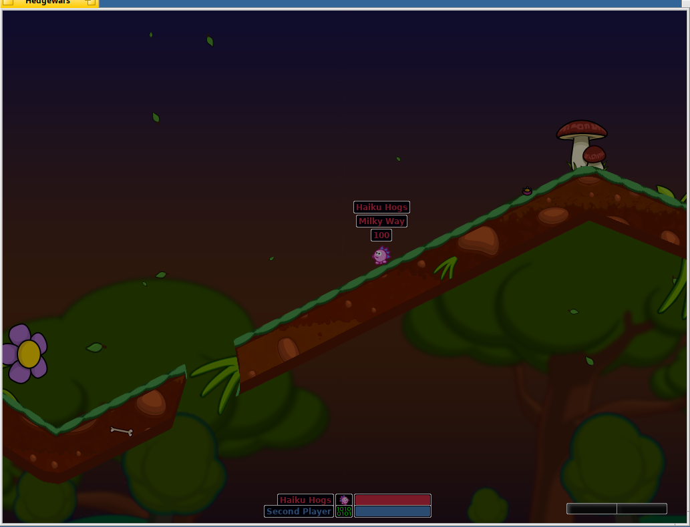
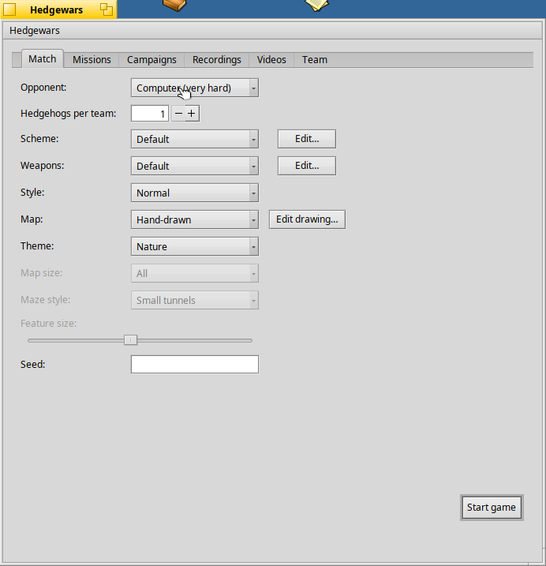
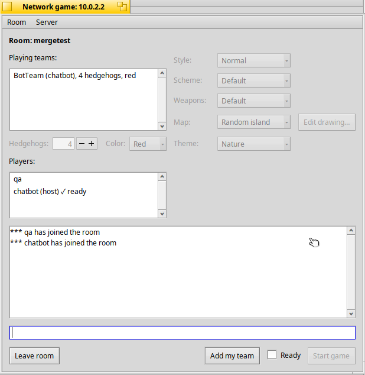
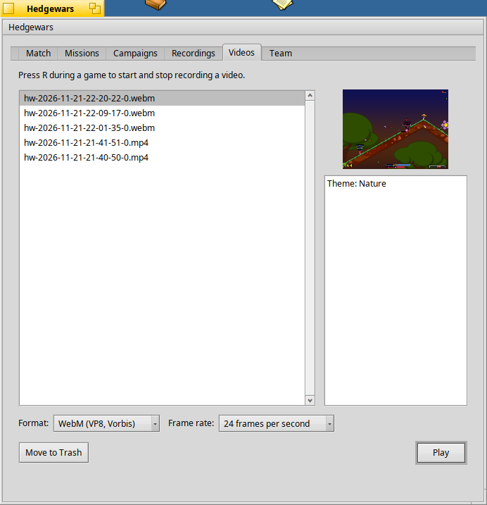
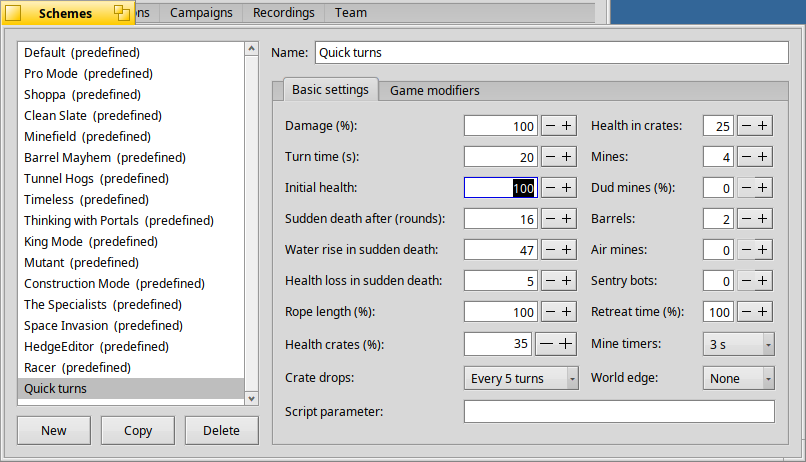

# Hedgewars for Haiku

[Hedgewars](https://hedgewars.org), the turn-based artillery game with
hedgehogs, running natively on [Haiku](https://www.haiku-os.org) and Renku
OS: no SDL, no Qt. The engine talks to the Haiku API directly, and a native
launcher replaces the Qt frontend.

| | |
|---|---|
|  |  |
|  |  |

This is an unofficial port, kept in a fork of
[hedgewars/hw](https://github.com/hedgewars/hw) on the `haiku` branch. It
was made with the help of an AI coding assistant (Claude); every feature
below was checked by playing it in Haiku virtual machines, and the
[Status](#status) table says exactly how.

## What you can do

- **Play a match** against the computer (five levels), a second player on
  the same computer, or one of your other saved teams. Choose the scheme,
  weapon set, game style, map (generated, hand-drawn or one of the game's
  maps), theme, and for generated maps the map size, maze style, feature size
  and seed.
- **Training, challenges, scenarios and campaigns**, with their pictures and
  descriptions; won missions are marked, campaigns unlock as you go.
- **Statistics** after a game: winner, ranking, awards and health graph.
- **Saved games and demos**: an interrupted game is kept and resumes where
  it stopped; a finished one is kept as a demo.
- **Videos**: press R in a game to start and stop recording. After the game
  the recorded stretch is rendered to MP4, WebM or Ogg at 24, 30 or 60
  frames per second, and Play opens it in MediaPlayer.
- **Teams**: as many as you like, each with name, player (human or computer
  level), flag, grave, fort, voice, hedgehog names and hats, and its own keys.
- **Your own schemes and weapon sets**, made in editor windows.
- **Hand-drawn maps**: draw with pencil, rectangle, ellipse and eraser;
  open and save the Qt frontend's `.hwmap` files.
- **Settings…** (Alt+,): language, window size, full screen, quality, frame
  rate display, damage display, sound, music, volume and key bindings.
- **Network game** (Hedgewars menu): connect to a Hedgewars server, chat in
  the lobby, create, join, follow or watch rooms, add your team, and play.
  The room's host sets the style, scheme, weapons, map (hand-drawn too),
  theme and each team's hedgehogs and colour, can lock the room with a
  password, rename it, restrict it, kick players or hand over hosting.
  Server admins get kick, ban and an administration window.
- **Downloadable content** (Hedgewars menu): add-ons from hedgewars.org.
  Their maps, themes, styles, hats and so on appear in the launcher's menus.

Settings, teams, recordings, videos, mission progress and add-ons live in
`~/config/settings/Hedgewars`, in the Qt frontend's file formats where it
has one (teams, schemes, weapon sets, `settings.ini`, drawn maps).

## Install

There's no release package yet. Build it (below), then:

    pkgman install haiku/build/hedgewars-1.1.0~dev-1-x86_64.hpkg

Hedgewars appears in Deskbar's Applications menu, and `hedgewars` starts it
from Terminal. The package needs Haiku R1/beta6 or Renku OS on x86_64, and
the system's ffmpeg 6, curl, OpenSSL and Mesa packages (installed by default
on both). Installing a package of the same version over an installed one
fails with "Name in use": uninstall the old one first.

## Build

On Haiku R1/beta6 (x86_64), from the top of the tree:

    pkgman install llvm19_clang mesa_devel glu_devel ffmpeg6_devel rust_bin curl_devel openssl3_devel
    make -f haiku/Makefile                 # haiku/build/Hedgewars/
    make -f haiku/Makefile test            # the tests
    sh haiku/package/build-hpkg.sh         # haiku/build/hedgewars-*.hpkg

`haiku/build/Hedgewars/Hedgewars` runs from the build folder too.

- `make -f haiku/Makefile test` builds and runs the tests of the code that
  needs no Haiku (surface blits, statistics, server protocol, add-on list
  and packages, INI files, drawn maps, scheme files; these also run on
  Linux) and, on Haiku, the launcher's progress file.
- `make -f haiku/Makefile compare` builds the Pascal engine with Free Pascal
  and checks that the C engine plays exactly like it (see below).
- `launcher/schemes.h` is generated from the Qt frontend's scheme list:
  `python3 haiku/tools/gen-schemes.py > haiku/launcher/schemes.h`.
- `HWHAIKU_DEBUG=1` makes the engine print every input event it receives;
  `HEDGEWARS_LOG_CONFIG=1` makes the launcher print the game setup it sends.

## How it works

**The engine.** `libhwhaiku` implements the parts of SDL2, SDL_ttf,
SDL_mixer, SDL_image and SDL_net that the engine (`hedgewars/SDLh.pas`) and
`misc/libphyslayer` call, on the Haiku API:

| Part | Haiku API |
|---|---|
| Window, OpenGL, input | `BApplication`, `BWindow`, `BGLView` (Mesa) |
| Text | `BFont`, loaded from the game's font files, drawn into a `BBitmap` |
| Images | Translation Kit |
| Sound and music | `BMediaFile` decoding, mixed in a `BSoundPlayer` |
| Joysticks | `BJoystick` |
| Link to the launcher | POSIX sockets |
| Video encoding | upstream's `avwrapper` on the system's ffmpeg 6 |

The engine is compiled from C. Upstream's pas2c converts `hedgewars/*.pas`
into `haiku/engine-c/` (`haiku/tools/gen-engine-c.sh`, run on a system with
GHC), and clang compiles it with upstream's stand-in for Free Pascal's
runtime (`project_files/hwc/rtl`). The Pascal stays the source; the C is
regenerated from it and committed, so building on Haiku needs neither GHC
nor Free Pascal. The C engine plays exactly like the Pascal one, which
matters because network games must not go out of sync: `make compare`
runs upstream's Lua tests on both and fails on any difference.

Changes to upstream code, all small:
- pas2c: `uConsts`' initialization section becomes a procedure under
  `PAS2C`; `Int8` and `PtrUInt` added to its types; `Control.Monad`
  imported (newer GHC).
- pas2c's runtime (`fileio.c`): `fileSize` left the file at its end, and
  `eof` was only true after a failed read; both broke video recording.
- `avwrapper.c`: converts the game's sound to the sample format and rate
  the encoder takes (AAC, Vorbis), and uses a named channel layout.

Haiku's Media Kit was tried first for video: on R1/beta6 its writer fails on
every audio track, so the engine uses ffmpeg, which Haiku's own media plugin
also uses.

**The launcher** (`haiku/launcher/`) is a native Haiku application. It runs
the engine and talks to it over a local socket, the way the Qt frontend
does. Code that doesn't need Haiku (file formats, the server protocol, the
add-on package reader) is kept apart and tested on any system.

Network protocol: what's implemented

NICK, PROTO, CONNECTED, PING/PONG, ERROR, WARNING, BYE, NOTICE (nickname
taken, room password), ASKPASSWORD/PASSWORD/SERVER_AUTH, LOBBY:JOINED/LEFT,
ROOMS, ROOM ADD/UPD/DEL, SERVER_MESSAGE, CHAT, INFO, CLIENT_FLAGS,
CREATE_ROOM (with password), JOIN_ROOM, JOINING, JOINED, LEFT, PART, KICKED,
ROOMABANDONED, ADD_TEAM, TEAM_ACCEPTED, REMOVE_TEAM, TEAM_COLOR, HH_NUM,
ROOM_NAME, TOGGLE_RESTRICT_JOINS, TOGGLE_RESTRICT_TEAMS,
TOGGLE_REGISTERED_ONLY, KICK, DELEGATE, BAN, BANIP, BANNICK, BANLIST, UNBAN,
GET_SERVER_VAR/SERVER_VARS, SET_SERVER_VAR, CLEAR_ACCOUNTS_CACHE, CFG (all of
FULLMAPCONFIG: MAP, MAPGEN, MAZE_SIZE, SEED, TEMPLATE, FEATURE_SIZE, THEME,
SCRIPT, SCHEME, AMMO, DRAWNMAP), TOGGLE_READY, START_GAME, RUN_GAME, EM,
ROUND_FINISHED, ROUNDFINISHED, FOLLOW, TEAMCHAT, QUIT; joining a room whose
game is running (the engine replays the game so far and watches).

Not implemented: INFO requests, the official server's recorded games
(REPLAY_START), REDIRECT, TLS, the lobby message preview and room list
filters.

## Status

Tested in QEMU virtual machines: Haiku R1/beta6 x86_64 and Renku OS x86_64,
software OpenGL (llvmpipe). Network play was tested only against the repo's
own server (`rust/hedgewars-server`) running locally, never the public one.

| | State |
|---|---|
| Engine, physics, AI, Lua, map generation | works; upstream's Lua tests: 6 of 7 pass, as with the Pascal engine, with identical output |
| Rendering, keyboard and mouse, sound and music | works (sound checked from the VM's captured audio) |
| Local matches | works: against the computer, a second player, or a saved team with its own hats, flag and keys; generated (island, maze, cave, forts, WFC), hand-drawn and fixed maps played |
| Training, challenges, scenarios, campaigns | listed and started like the Qt frontend; Basic Movement played; not each one played through |
| Saved games, demos, statistics | works |
| Video recording | works: MP4 and WebM clips made from matches play in MediaPlayer with sound; size (1280×720) and bit rate are fixed. Very slow on Renku in a VM (software OpenGL) |
| Settings, key bindings, teams | works: window size, frame rate display and German texts checked; a rebound key and a team's own key worked in a game |
| Scheme and weapon set editors | works: a 20-second turn time and a changed bazooka count reached the engine |
| Network play | works: full games between Haiku and Renku in sync to the end (the same statistics on both); lobby, room and team chat, passwords, room flags, follow, watching a running game (only checked at its start), drawn maps, your own schemes in rooms, the admin commands |
| Downloadable content and add-ons | works: the list loads from hedgewars.org; a downloaded theme and a test package's map, hat and flag showed in the menus and were played |
| Large fonts | checked at 15 pt: no clipping in any window |
| Package | builds and passes the artifact checks; installed system-wide on Haiku R1/beta6 and in the home folder on Renku (build00073), started from Deskbar: a match, a recorded video, Settings and a network room |
| Joysticks | written, not tested (no joystick in the VM) |
| arm64 | not built: Renku OS arm64 has no OpenGL (no Mesa, no OpenGL kit), and Rust has no aarch64 Haiku target |

Known issues:
- Registered nicknames (the password exchange) are written but untested:
  the local server has no accounts.
- An add-on downloaded while the launcher runs shows in its menus only
  after a restart; add-on missions are listed without their pictures.
- Watching a long game in progress: the moves so far are handed to the
  engine before it starts, so the network window can stall for a moment.
- `tests/lua/luaAPI/gravity_get_set.lua` misses its tolerance by 0.5 px,
  with both engines, so it's in engine physics, not in this port.

## Interface guidelines

The launcher follows the [Haiku Human Interface
Guidelines](https://www.haiku-os.org/community/getting-involved/designing/):
sentence case, alerts that say how to fix the problem, window sizes and
places remembered, a default button where there's a main action, dates in
the system's format, every control reachable with Tab, no clipping at
15 pt. Where it differs:

- Settings live in the Qt frontend's `settings.ini` rather than a flattened
  `BMessage`, because the engine reads its key bindings from that file.
  There are no proxy, stereoscopy or zoom settings.
- Scheme, weapon set and map names keep the game's capitals ("Pro Mode"):
  they are names that Hedgewars players know.
- Flags, graves and forts are listed by name, without pictures.
- Mission and campaign lists follow the game's order, not the alphabet.
- No Help menu: Hedgewars has no offline manual.
- The network lobby and room have no default button: Enter sends the line
  typed in their chat fields.

## License

Hedgewars is free software under the GNU General Public License, version 2
(see `COPYING` at the top of the tree), by Andrey Korotaev and the
Hedgewars contributors. The Haiku port is under the same license.
